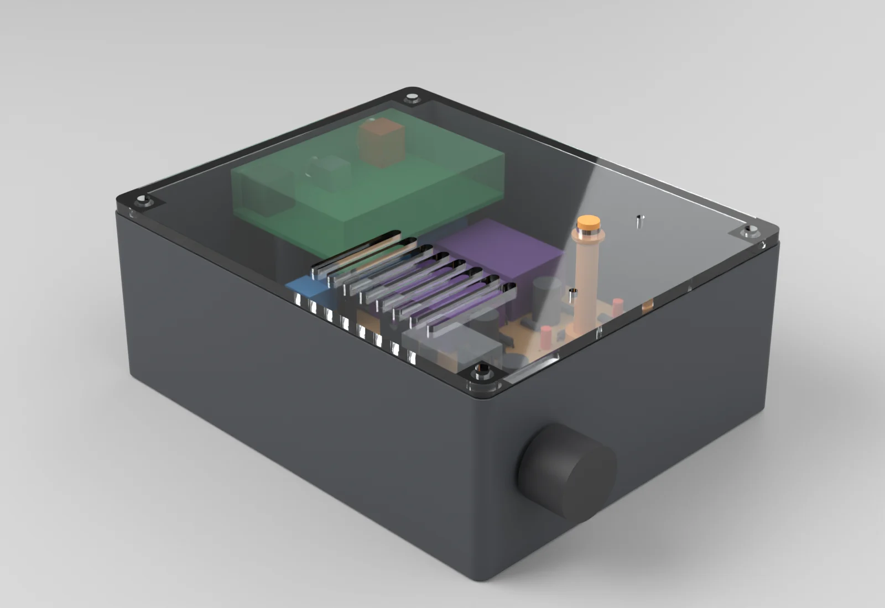
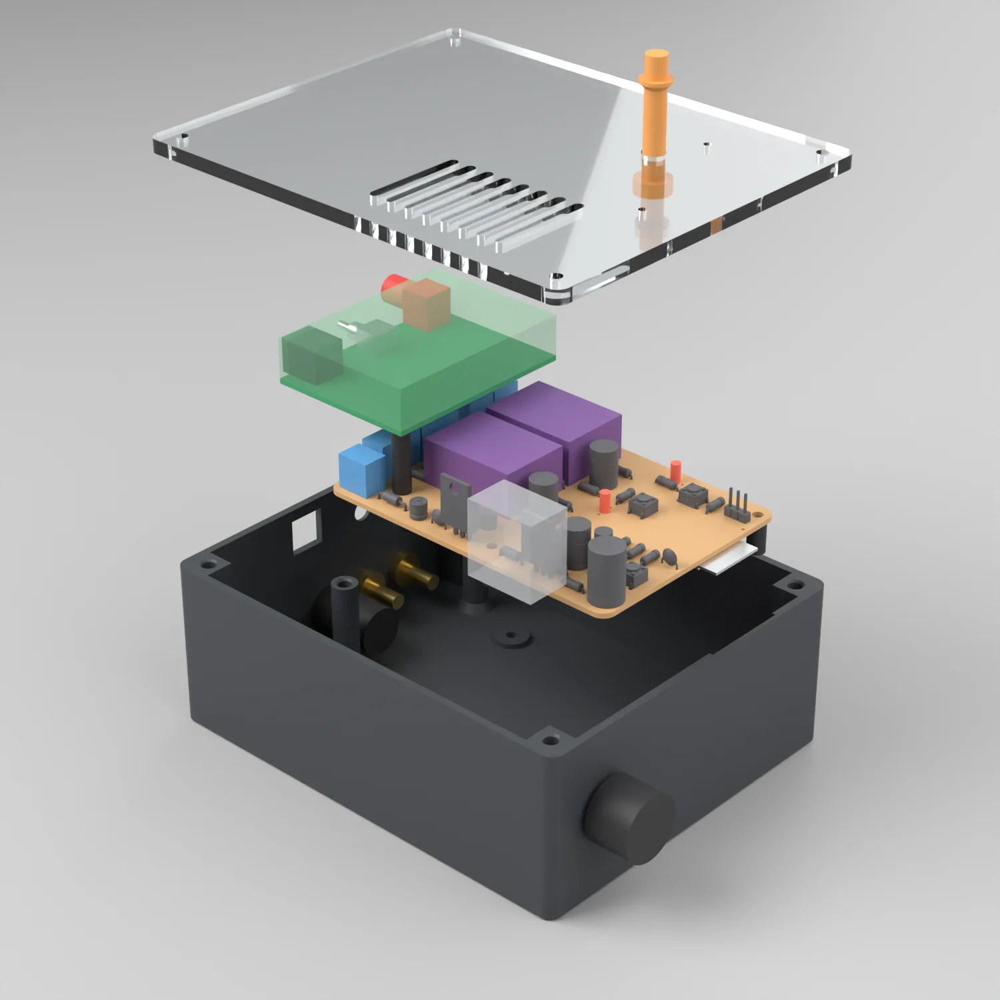

# ESP32 surround processor

A four-speaker surround processor built around an ESP32. It takes the optical output of a TV, decodes Dolby Digital 5.1 in firmware, and drives two DACs: a front pair and a rear pair.

The receiver recovers the clocks from the optical signal and everything else follows them. The ESP32 is a slave on both of its I2S ports.

## What it does

- Dolby Digital 5.1 from the TV is decoded on the ESP32 and played on four speakers.
- Plain stereo goes to the fronts untouched, and the rears get a stereo matrix signal.
- DTS and Dolby Digital Plus are recognised and kept silent.
- A potentiometer sets the volume, and the board updates over Wi-Fi.

## The board

The board is 101.9 x 73.2 mm with copper on both faces, milled on a desktop CNC. The holes are not plated and there are no vias: the two faces meet only at 19 component leads soldered on both sides. The top face is a ground plane, and every clock, data and audio signal stays on the bottom. The layout is written as code, and a separate check proves the board is connected with bare holes, which KiCad's own rule check cannot do.

The pictures are renders made from the KiCad board file in Blender. The copper, the isolation channels, the legend and the part positions are the real design; the DAC and receiver modules are simplified stand-ins. The flat layer plots are in [docs/board.md](docs/board.md).

## Enclosure

A printed base with a laser-cut lid in 4 mm clear acrylic, held by M3 screws in heat-set inserts. The optical input, the coax input and the four outputs are on the rear panel, the volume knob on the front. It is designed and collision-checked as a model, and not printed yet; the files are in `enclosure/`.

## Measured

| | Result |
|---|---|
| Decode time | 5.3 ms average per 32 ms frame, with a film playing |
| Damaged frames | 0 in 48,044 |
| Channel separation | each channel on its own output, the others below -108 dBFS |
| Line outputs | 0.50 to 0.52 V rms at 1 kHz, -12 dBFS |
| Supply rails | 4.98 V and 3.21 V |

## What went wrong

- The vendor's I2S driver lost a 5 ms buffer now and then, because two interrupt handlers cleared each other's flags. A patched copy of the driver fixes it.
- The ESP32 drove its two data lines hard enough to disturb the clock lines beside them, and the DACs misread bits. The weakest drive setting is clean.
- The Dolby Digital decoder kept its FFT temporaries in doubles, and the ESP32 has no hardware for those. Single precision took the decode from 21 ms to about 5 ms per frame.

The full story is on the [project page](https://madsrudolph.dev/projects/esp32-surround-processor).

## Debug page

The board's debug page while a film plays. It shows the input format, levels and decoder health, and can play a chime or a sine sweep on one speaker at a time.

## More

- [docs/board.md](docs/board.md): file layout, rebuilding, fabrication rules, routing rules and the board concept
- [docs/firmware.md](docs/firmware.md): the firmware projects, build commands and the faults in detail
- [docs/bench.md](docs/bench.md): the bring-up page and the Analog Discovery 3
- [hardware/BUILD-NOTES.md](hardware/BUILD-NOTES.md): milling order, assembly order and module straps

## Status

The board is cut, soldered and working, and the firmware has been tested with a TV on four speakers. The enclosure is designed but not printed. The mute pin on the DAC modules does not mute, so mute is done in the audio data. Writing my own AC-3 decoder in place of liba52 is the next step.

## Licence

Copyright (C) 2026 Mads Rudolph. The firmware, the tools and the hardware design files
are free software under the **GNU General Public License, version 3 or (at your option)
any later version**; see `LICENSE`. They come with no warranty.

Two parts are other people's work and keep their own licences:

- `firmware/components/liba52/`: liba52 from a52dec 0.7.4, (C) Aaron Holtzman and Michel
  Lespinasse, GPL version 2 or later (`COPYING` in that folder). One file is changed, with a
  notice at its top.
- `firmware/components/esp_driver_i2s/`: the I2S driver from ESP-IDF v5.5, (C) Espressif
  Systems, Apache License 2.0 (`LICENSE` in that folder). One file is changed, with a notice
  at its top.

The firmware links both with ESP-IDF (Apache 2.0), which is why the whole is GPL version 3:
that is the GPL version compatible with the Apache licence.

"Dolby" and "Dolby Digital" are trademarks of Dolby Laboratories. This project is not made,
tested or endorsed by Dolby.
