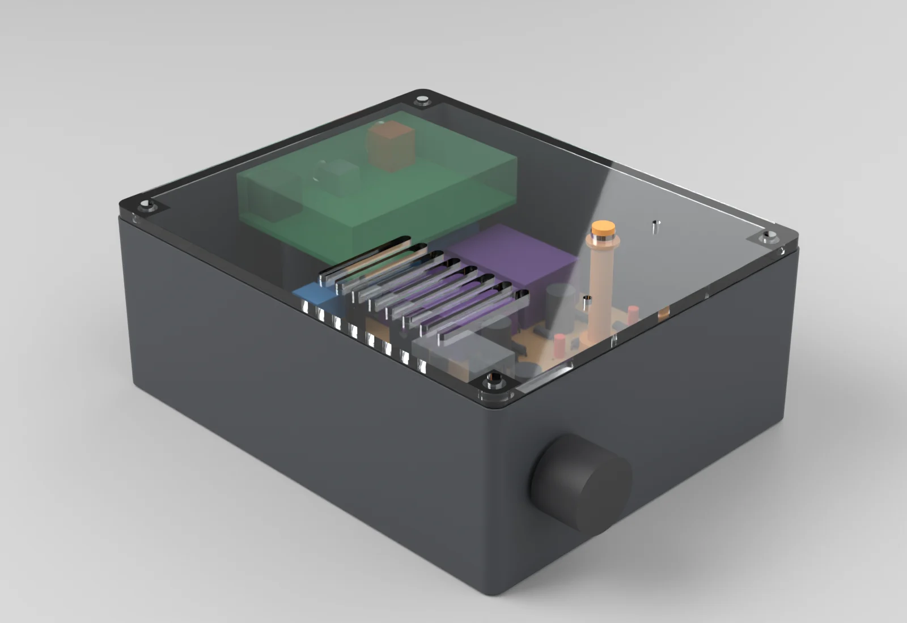
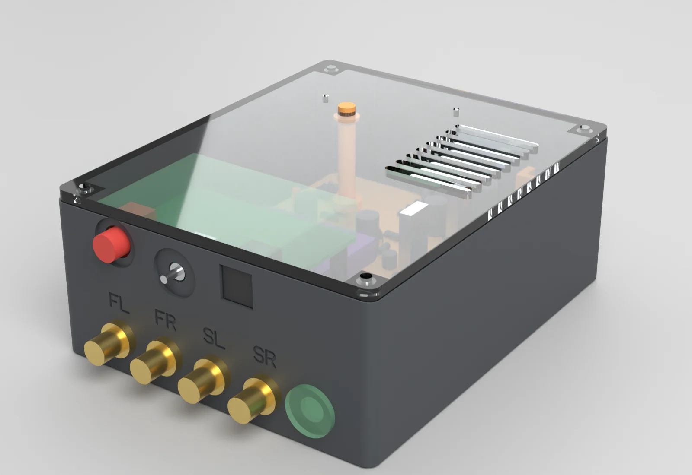
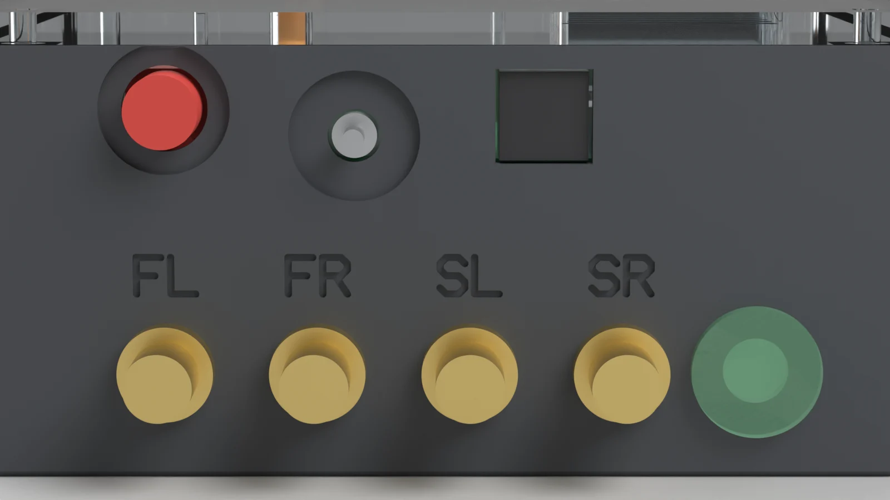
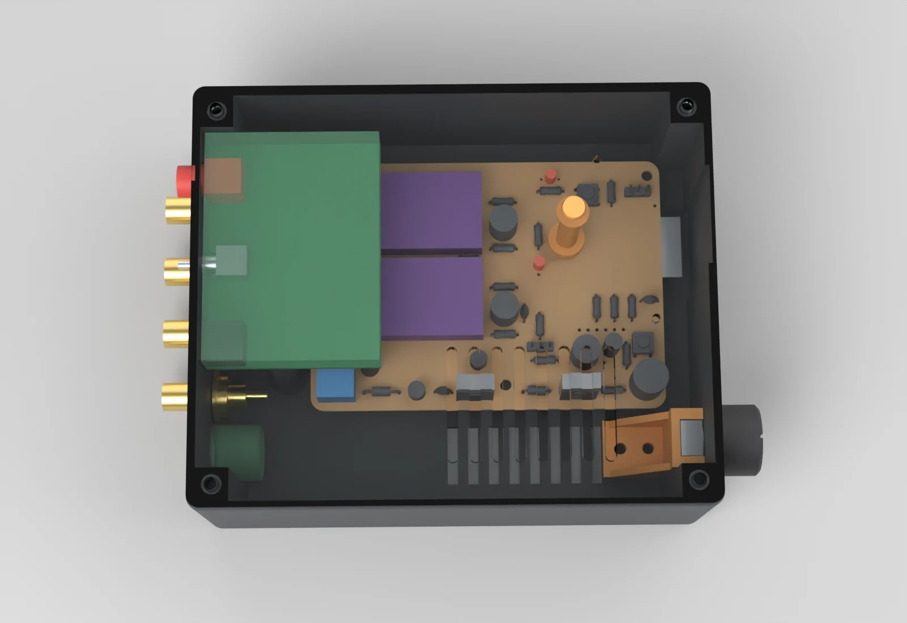
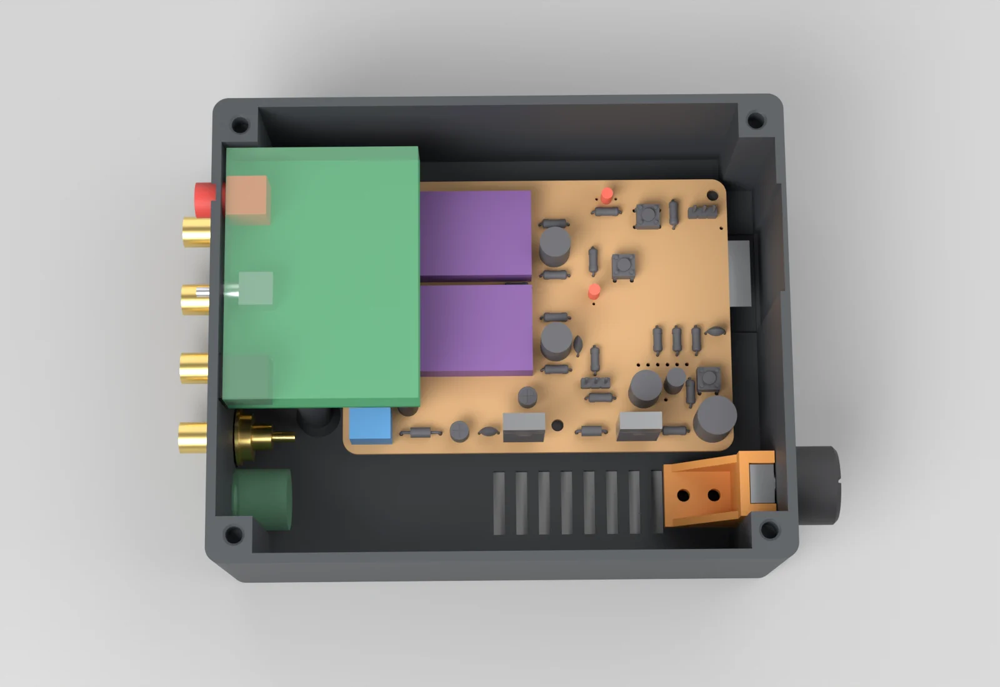
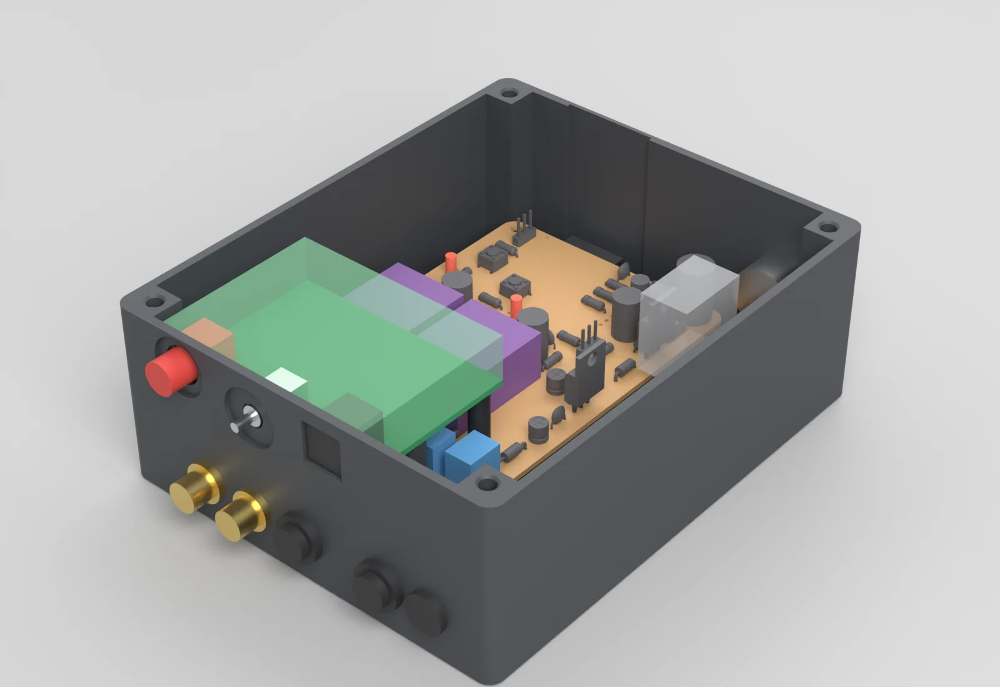
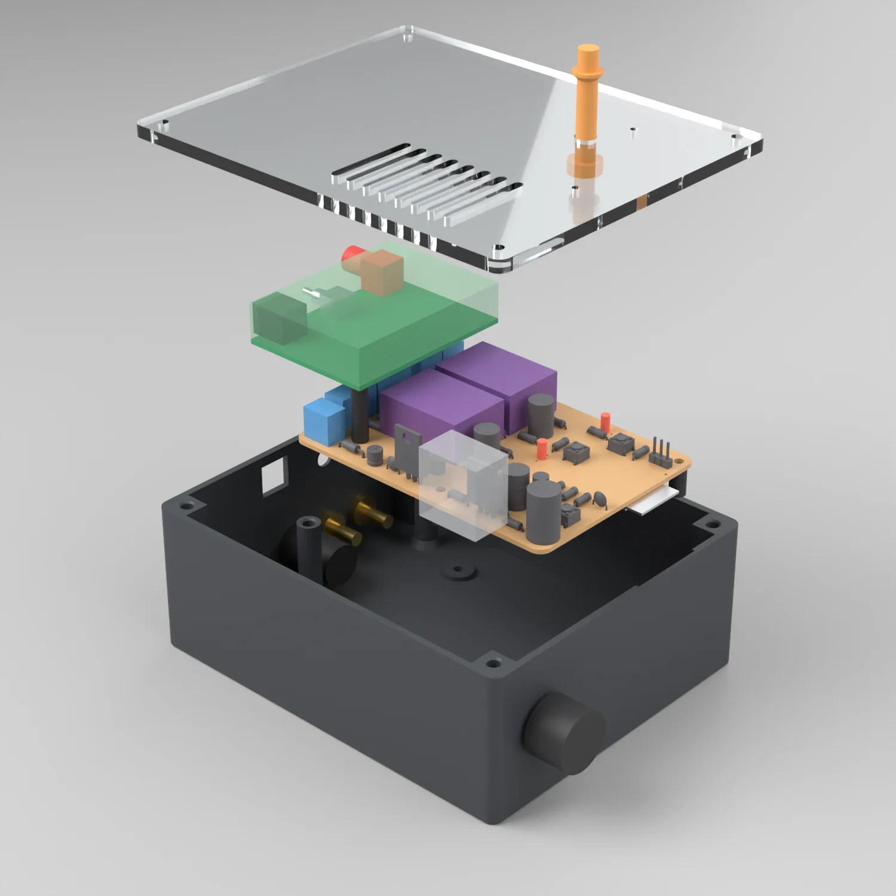
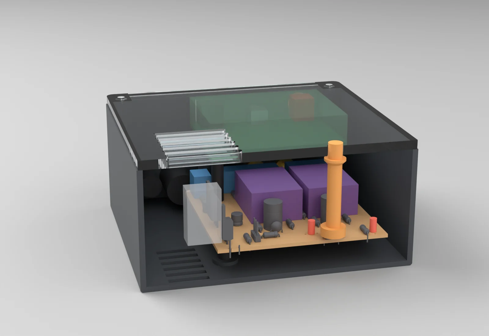
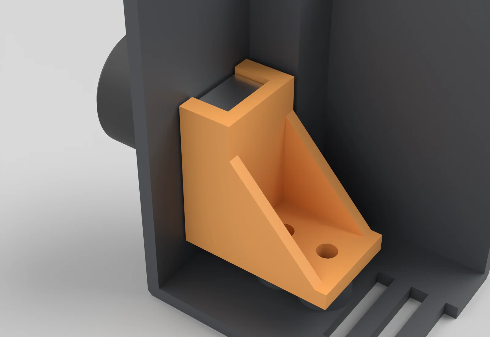

# Enclosure

A printed base that carries everything, closed by a flat lid laser cut from 4 mm clear acrylic and
held by four M3 screws into heat-set inserts in the base. Outside 143 x 117 x 57 mm.

**Nothing has been printed, cut or test-fitted yet.** The carrier board comes from the KiCad file.
Heights and the module's position come from Mads's caliper measurements, the DIR9001 module's outline
from the seller's dimension drawing, the pot's body from a photo against a ruler. What is still
assumed is listed under [Before you print](#before-you-print) and in [MEASUREMENTS.md](MEASUREMENTS.md).











In the renders the green board with the translucent block over it is the DIR9001 module, the purple
blocks are the PCM5102 modules, the blue blocks are the screw terminals, and the translucent disc on
the rear wall is the space kept clear for the DC jack. They are envelopes, not models of the real parts.

## Before you print

The base is ready to print as far as the measured values go. These are the remaining risks.

1. **Toggle position on the module (item 11b).** The TOSLINK was measured 6 mm from the end of the module.
   With the drawing's 23 mm spacings that puts the toggle 29 mm and the coax 52 mm from that end. The
   drawing's own proportions say 9, 32 and 55. If the toggle is really 32 mm from the TOSLINK end, all
   three openings in the rear wall are 3 mm off. Measure that one distance first. It is `DIR_OPT_U`.
2. **The pot's body is from a photo.** 9.8 x 11.3 mm, good to about 0.5 mm, and the collar length
   (2 mm) is a guess. Print `print/Pot_Fit_Test.stl` and `print/Pot_Cradle.stl` first: a 32 x 29 x 38 mm
   corner of the base with the collar hole and the two bosses. If the pot fits there, it fits the base.
3. **The DC jack is not in hand.** Its hole is 8.0 mm on purpose, with a flat 16 mm land inside and
   out. If the jack's thread is bigger, drill the hole out, up to 12 mm.
4. **RCA nuts and depth are scaled from a picture.** The holes (7.3 mm for the measured 7 mm thread)
   and the 16 mm lands are safe; they can also be opened to 12 mm.
5. **The two module pillars are slender**, 8 mm across and 35 mm tall. Print the base with at least
   3 perimeters and do not lever on them.
6. **Kerf of the laser** is assumed 0.20 mm. Nothing on the lid is a tight fit.
7. **USER switch body** is assumed 6.2 mm square and 3.5 mm tall. The button cap's skirt fits over it.

## Mounting of the DIR9001 module

On the bench the module is stacked over the DAC modules with its TOSLINK socket, toggle and coax
RCA all on one edge, pointing east across the carrier toward the ESP32. No panel can reach them there.

In the enclosure the module stays stacked at the same height, but is **turned 180 degrees and moved
about 40 mm west**, so the socket, the toggle and the RCA jack pass through the rear wall. Mads has
agreed to this. It is the intended mounting, and the base is built round it.

### Re-mounting the module

1. Unplug the pigtail and take the module off its standoff.
2. Fit the carrier in the base (four screws from below into its standoffs).
3. **Wire the west screw terminals J3 to J6 now.** The module covers them afterwards, 12 mm above
   their screws, and has to come off again to reach them. J1 (9 V) stays reachable.
4. Leave the standoff on carrier hole **H3** (south-west, next to the 9 V terminal) where it is. It is
   the one the module already stands on. The standoffs on H1, H2 and H4 carry nothing.
5. Turn the module so its sockets point west. Push the TOSLINK, the toggle and the RCA barrel into
   their openings in the rear wall, then lower the module.
6. It now rests on three points:
   - the H3 standoff, under the hole at the module's south-east corner, next to the I2S-OUT end;
   - two printed pillars in the base, 7.5 mm from the carrier's west edge, under the two holes nearest
     the sockets. They stand in the jack bay, 12.5 mm and 68.5 mm north of the board's south edge.

   The fourth hole (north-east) is over bare board and stays empty.
7. Three M3 x 6 screws: two into the pillar inserts, one into the H3 standoff.
8. Plug the pigtail back in.

### Pigtail

I2S-OUT is on the module's east edge after the turn, 22 mm above the carrier. A2 is about 69 mm away
in a straight line. The pigtail is over 100 mm (measured), which is enough for a relaxed run that drops
off the module's east edge and crosses the board south of the DAC modules, clear of the USER button cap.

### The openings for the module

The TOSLINK receiver stands 1.5 mm into its window. The toggle and the coax jack sit in shallow recesses
on the outside of the wall, so the lever and the RCA barrel each stand 5.8 mm proud of the recess floor.
Heights are from the measured 22 mm standoff and the seller's drawing. Positions along the wall depend
on item 1 under Before you print.

## Layout

The board keeps its KiCad orientation. "West" and "south" below are the board's own edges.

| Side | What is on it |
|---|---|
| Rear (west wall), upper row | Coax RCA, input toggle, TOSLINK: the DIR9001 module's own parts, through openings in the wall. |
| Rear (west wall), lower row | Four identical gold RCA jacks, 18.5 mm apart, then the 9 V jack. From the north end: front left, front right, surround left, surround right, 9 V. Same order as the terminals J3 to J6 and J1 behind them. FL, FR, SL and SR are sunk 0.6 mm into the wall above the jacks. |
| Front (east wall) | Volume knob at the south end, in a shallow recess. The WROOM-32 antenna sits behind the plain part of this wall, 45 mm from the pot. |
| Lid (clear acrylic) | The USER button, pin holes over BOOT and RESET, vent slots over the regulators. The status, power and lock LEDs show through the plate. |
| Floor | Vent slots beside the regulators, four screw holes for the carrier's standoffs, two pillars for the module, two bosses for the pot cradle. |

- The carrier has four M3 mounting holes, H1 to H4, and already has 10 mm hex standoffs under them. The
  base takes four countersunk screws from below into those standoffs. The floor is 1.6 mm thicker under each one.
- The wall in front of the antenna and the floor under it are thinned to 1.2 mm. The nearest metal is the
  board's own H2 screw (12.7 mm) and a lid insert (21.3 mm).
- There are 28 mm between the board's west edge and the rear wall, of which the RCA jacks take about 15,
  and 29.5 mm south of the board for the 9 V jack and the pot.
- All panel parts are in the base, so the lid comes off without unplugging anything.
- The UART header J2 and the DIP switches on the module are reached with the lid off.

### Rear jacks

The RCA jack goes in from outside, hex flange against the wall, nut and solder tag inside. The holes are
7.3 mm for the measured 7 mm thread. The seller's "12 mm fixing hole" is for the shoulder of the two white
insulating washers. A printed wall is an insulator, so those washers are not needed; a flat washer may go
under the nut. The wall is thinned to 2.0 mm from the inside over a 16 mm circle at each jack, which is
what the jack can clamp and where the nut or a 15 mm washer seats. If the shouldered washers are wanted
after all, open the hole to 12 mm.

The rear labels are single strokes 0.9 mm wide and 4.5 mm tall. They should read on a 0.4 mm nozzle
but have not been printed. There are no labels on the upper row or the 9 V jack.

### Volume pot

The pot has no threaded bushing, so it cannot be clamped to the wall with a nut. Its 7 mm collar goes
through a 7.3 mm hole in the front wall and its body is held from behind by a separate printed part,
`Pot_Cradle`: a channel with two cheeks and a solid back on a flange, held by two M3 screws into inserts
in two floor bosses. The cheeks grip the two faces of the frame that are 9.8 mm apart and take the
turning torque. The back takes the push on the knob. Neither load goes into the wires.

The pot goes in with its three pins pointing down. The channel is open at the bottom and stands 5.5 mm
above the floor, so the pins hang free inside it and the wires leave underneath. Nothing presses on the pins.

The front wall is thinned to 1.2 mm from the outside over a 24 mm circle, and the knob sits in that
recess. With a 2 mm collar the knob grips 7.8 mm of the 8 mm D-shaft. If the 8 mm was measured from the
body instead of from the end of the collar, it grips 5.8 mm, which still holds.

`Knob` is a plain 20 mm printed knob for the 6 mm D-shaft with a pointer groove. It is optional.

To fit the pot: push the collar through the hole from inside, slide the cradle up behind the body from
the west, and fit the two screws through the holes in the flange.

## Printed parts

| Part | File | Size as printed | Orientation | Supports |
|---|---|---|---|---|
| Base | `print/Base.stl` | 143.1 x 116.8 x 53.2 mm | Floor on the bed, open side up | None. The wall openings are round holes up to 10.5 mm, shallow recesses, and one 11.8 mm bridge over the TOSLINK window. |
| User button | `print/User_Button.stl` | 10.5 x 10.5 x 41.1 mm | Skirt on the bed, stem up | None. The inside of the skirt is a 6.6 mm bridge and the collar has a 45 degree underside. Use a brim; it is a 6 mm pin 41 mm tall. |
| Pot cradle | `print/Pot_Cradle.stl` | 26.2 x 16.4 x 25.6 mm | Flange on the bed, channel up | None |
| Knob (optional) | `print/Knob.stl` | 20 x 20 x 14 mm | Face on the bed, bore up | None |
| Pot fit test | `print/Pot_Fit_Test.stl` | 31.9 x 29.0 x 37.5 mm | Floor on the bed | None. A corner of the base, for checking the pot before the full print. |

The STLs are already in these orientations, in millimetres. STEP files of each part are in `cad/`.

Suggested settings, not tried: 0.4 mm nozzle, 0.2 mm layers, 3 perimeters, 20 % infill, PETG or PLA.
PETG if the regulators run warm. Walls and floor are 2.4 mm.

### The USER button

The cap is a loose part. Its skirt slips over the body of the 6 mm USER switch, which keeps it centred,
and its stem comes up through a 6.6 mm hole in the acrylic, 1.5 mm proud. A collar on the stem 1 mm under
the plate stops the cap lifting off the switch when the box is turned over. Nothing is attached to the
plate. The cap's length comes from the measured 4 mm plunger height.

BOOT and RESET are 2.2 mm holes in the plate straight above the switches, which are 34 mm further down.
Use a straight 2 mm pin.

## Laser-cut lid

| | |
|---|---|
| Material | Clear acrylic (PMMA), 4 mm. Cast sheet engraves better than extruded. |
| Size | 142.1 x 115.8 mm, corners R3.5. It is 0.5 mm smaller than the base all round. |
| Files | In `lasercut/`, all three with the same drawing, 1:1, millimetres. See below for which to open. |
| Laser | CO2. A diode laser does not cut clear acrylic. |

Which file to use:

| File | What |
|---|---|
| `Lid_Plate_4mm_acrylic.dxf` | DXF, AutoCAD 2018 format (AC1032). Open this one first, in Illustrator or in the laser software. |
| `Lid_Plate_4mm_acrylic_R2000.dxf` | The same drawing as AutoCAD 2000 (AC1015). Use it if a program will not open the 2018 file. |
| `Lid_Plate_4mm_acrylic.svg` | The same drawing as SVG. The fallback if neither DXF works. Opens at true size. |

In Illustrator, when the DXF import dialog asks about scale, choose 1 unit = 1 millimetre (original
size), not "scale to fit artboard". The rounded corners and the slot ends must import as curves; if
they show as straight cut-off corners, use the SVG instead. The SVG lines are 0.0254 mm (0.072 pt,
0.001 in) wide, the usual hairline that laser drivers read as a vector cut.

Check the scale after import: the red outline must measure **142.33 x 116.00 mm** (select it and read
W and H in the Transform panel). That is the plate (142.13 x 115.80 mm) plus the kerf allowance
described below. The M3 holes are 3.20 mm across in the drawing, and their centres are 129.33 mm apart
in X and 103.00 mm apart in Y. In the SVG the artboard is 144.33 x 118.00 mm, the plate with a 1 mm
margin.

The drawing is seen from above, outside face up. The front of the box is on the right.

| Layer | Colour | Use |
|---|---|---|
| `CUT` | red (ACI 1), hairline | Cut through: outline, four M3 holes (3.4 mm), USER button hole (6.6 mm), BOOT and RESET pin holes (2.2 mm), eight vent slots (3 x 31 mm). The outline and the slots are closed shapes. |
| `ENGRAVE` | blue (ACI 5), hairline | Engrave: USER, BOOT, RESET and SURROUND 4.0. Single-line strokes, not text, so no font is needed. Run it as a low-power line, not as a fill. The labels read from the front of the box. |
| `LED_OPTIONAL_NOT_FOR_CLEAR_ACRYLIC` | green (ACI 3) | Two 3.2 mm holes over the LEDs. **Not for clear acrylic.** Delete the layer or set it to no output. It is only there in case the lid is ever cut from an opaque sheet. |

In the SVG each layer is a group with the same name. To regenerate the files (needs `ezdxf`; `uv`
fetches it):

```sh
uv run --no-project --python /usr/bin/python3 --with ezdxf python3 enclosure/lasercut.py
```

`design.py` writes them too, and runs that command by itself when its Python has no `ezdxf`.

Kerf: the cut lines are already compensated for a 0.20 mm kerf, a typical figure for a CO2 laser in
4 mm acrylic. Holes and slots are drawn 0.10 mm smaller per side and the outline 0.10 mm larger. Check
the real kerf with a test cut (a 20 mm square, measured), put it in `LASER_KERF` in `design.py` and
re-run. If the laser software applies its own kerf offset, set `LASER_KERF = 0` instead. Nothing on
this plate is a tight fit, so an uncorrected kerf only costs a tenth or two of clearance.

How it sits: the plate lies on top of the walls and the four corner bosses and is located by its four
screws. It does not drop into a rebate. A rebate would leave a 1.2 mm rim of printed wall round a
sheet whose thickness and cut size both vary by a few tenths, and that rim is the first thing to
break. The price is that the edge of the acrylic is exposed; it is set 0.5 mm inside the base so it
does not catch.

Peel the film after cutting. Do not overtighten: acrylic cracks at the holes. Stop when the screw
head touches, or put a nylon washer under it. Do not countersink.

To engrave on the underside instead, so the lettering is protected, mirror the `ENGRAVE` layer left
to right before cutting and turn the plate over.

## Fitting the inserts

Standard M3 brass heat-set inserts, 4.6 mm outer diameter, 5.7 mm long. Eight of them: one in each
corner boss for the lid, one on top of each module pillar, two in the floor bosses for the pot cradle. The pockets are 4.2 mm across and 6.7 mm
deep with a 0.6 mm chamfer at the mouth, and each corner boss has 2.4 mm of plastic round the pocket.
If an insert looks different, measure it and change `INSERT_OD`, `INSERT_LEN`, `INSERT_PILOT_D` and
`INSERT_PILOT_DEPTH` before printing.

1. Set the iron to 200 to 230 °C for PLA, 230 to 260 °C for PETG. Use a plain conical or an insert tip.
2. Stand the insert in the chamfer, narrow end down. Rest the tip in it and let its own weight take it down. Do not push hard.
3. Stop when the top is flush with the plastic, or a hair below. On the corner bosses it must not stand proud, or the plate will rock on it.
4. Take the iron out and at once press something flat (a steel rule) on the insert to square it up.
5. Let it cool for a minute before putting a screw in.

Do the two pillars with care: they are slender. Support the pillar with pliers while pressing.
The two cradle bosses are low and next to the front wall; reach them with the iron upright.

## Hardware

Parts Bin lists no mechanical hardware, so the sources need confirming.

| Item | Qty | Where it goes | Source |
|---|---:|---|---|
| M3 heat-set insert, 4.6 mm OD x 5.7 mm | 8 | 4 corner bosses for the lid, 2 module pillars, 2 pot cradle bosses | home (per Mads) |
| Clear acrylic sheet, 4 mm | 1 piece, 150 x 125 mm or larger | The lid | buy or home: confirm |
| M3 x 10 pan or button head screw | 4 | Lid, through the acrylic into the inserts | buy (assumed) |
| M3 x 8 countersunk screw | 4 | From below into the carrier's standoffs | buy (assumed) |
| M3 x 8 pan head screw | 2 | Pot cradle | buy (assumed) |
| M3 x 6 pan head screw | 3 | The module: 2 into the pillars, 1 into the H3 standoff | buy (assumed) |
| Hex standoffs under and on the carrier | as fitted | Already on the board | home |
| Gold RCA panel jack | 4 | Rear wall | home (he has ten) |
| 5.5 x 2.1 mm DC panel jack | 1 | Rear wall | buy: on order |
| Stick-on rubber foot, 3 mm or taller | 4 | Under the base, so the floor vents can breathe | buy (assumed) |

## Assembly

1. Press the eight inserts in (see Fitting the inserts).
2. Fit the four RCA jacks and the 9 V jack in the rear wall.
3. Fit the pot and its cradle (see Volume pot).
4. Lower the carrier in, antenna end toward the front wall, and fit four screws from below into its standoffs.
5. Wire the terminals and plug in the pot.
6. Fit the module as described under Re-mounting the module. Plug in the pigtail.
7. Slip the user button over the USER switch. Lower the acrylic plate over its stem and fit four M3 x 10 screws.
8. Push the knob on.

## Where the dimensions come from

Every dimension that is not from KiCad is in one block at the top of `design.py`, each line marked
MEASURED, seller drawing, photo with ruler, or ASSUMED.

Measured by Mads with calipers:

| Parameter | Value | What it is |
|---|---:|---|
| `BOARD_T` | 1.6 | Board thickness |
| `CARRIER_STANDOFF_LEN` | 10 | Standoffs under the carrier. Sets the floor height. |
| `CARRIER_TALLEST` | 24 | Top of the L7805 above the board |
| `DAC_TOP_ABOVE_BOARD` | 8 | PCM5102 modules |
| `TERMINAL_H`, `CAP_C1_H` | 10, 14 | Screw terminals, the blue 470 uF can |
| `LED_TOP_ABOVE_BOARD` | 6 | LED domes |
| `TACT_TOP_ABOVE_BOARD` | 4 | USER switch plunger |
| `DIR_ABOVE_BOARD` | 22 | Carrier top face to the underside of the module |
| `DIR_COMP_H` | 12 | Tallest part on the module. With the 22 it sets the height of the box. |
| `DIR_OPT_U`, `DIR_OPT_OVERHANG` | 6, 2.5 | TOSLINK centre from the board end, front past the board edge |
| `DIR_TOGGLE_BUSH_OVERHANG`, `DIR_TOGGLE_TIP_OVERHANG` | 2, 8 | Toggle bushing and lever tip past the board edge |
| `DIR_CONN_OVERHANG` | 8 | Coax barrel past the board edge |
| `RCA_THREAD_D`, `RCA_WASHER_D` | 7, 15 | RCA jack thread and washer |
| `POT_COLLAR_D`, `POT_SHAFT_D`, `POT_SHAFT_LEN`, `POT_BODY_DEPTH` | 7, 6, 8, 6 | Pot collar, D-shaft, shaft length, body depth |

From the seller's dimension drawing of the DIR9001 module:

| Parameter | Value | What it is |
|---|---:|---|
| `DIR_W`, `DIR_L`, `DIR_T` | 64, 48, 1.6 | Board; the sockets are on a 64 mm edge |
| `DIR_HOLE_PITCH_W`, `DIR_HOLE_PITCH_L`, `DIR_HOLE_FROM_EDGE` | 56, 24.5, 19.5 | Holes: 4 mm in from each end, rows 4 and 28.5 mm from the I2S-OUT edge |
| `DIR_TOGGLE_U`, `DIR_RCA_U` | +23, +23 | TOSLINK to toggle to coax, centre to centre |
| `DIR_OPT_BODY_W`, `DIR_OPT_BODY_H`, `DIR_OPT_ZC` | 10.8, 10.8, 5.6 | TOSLINK body and optical axis above the board. The drawing's "0.56 cm" is read as the axis height. |
| `DIR_TOGGLE_BUSH_D`, `DIR_TOGGLE_ZC` | 5.5, 3.0 | Toggle bushing and axis height |
| `DIR_RCA_BARREL_D`, `DIR_RCA_ZC` | 9.0, 6.3 | Coax barrel and centre height |
| `DIR_I2S_U` | 33 | I2S-OUT centre from the TOSLINK end, scaled from the drawing |

From Mads's photo of the pot against a steel rule, good to about 0.5 mm:

| Parameter | Value | What it is |
|---|---:|---|
| `POT_BODY_W`, `POT_BODY_H` | 9.8, 11.3 | Metal frame across and along the pins' direction |
| `POT_AXIS_ABOVE_PIN_SIDE` | 6.6 | Shaft axis above the edge the pins leave |
| `POT_PIN_LEN`, `POT_PIN_SPAN` | 7, 6.5 | Pins with solder joints, and the width across the three |

Still assumed:

| Parameter | Value | What it is |
|---|---:|---|
| `POT_COLLAR_LEN` | 2.0 | Length of the pot's collar. Sets how much shaft the knob gets. |
| `POT_PIP_H` | 0.5 | The two small bosses on the pot's front face |
| `POT_D_FLAT` | 4.5 | Across the flat of the D-shaft |
| `DC_HOLE_D`, `DC_LAND_D`, `DC_FREE_DEPTH` | 8.0, 16, 14 | 9 V jack: starting hole, clear land, depth kept free |
| `RCA_NUT_D`, `RCA_BEHIND`, `RCA_OUTSIDE` | 12.6, 15, 12.2 | RCA jack nut and lengths, scaled from the seller's picture |
| `TACT_BODY`, `TACT_BODY_H` | 6.2, 3.5 | USER switch body |
| `CAP_SMALL_H`, `LEAD_TRIM` | 12, 2.5 | Small cans; longest lead under the board |
| `CSK_D`, `CSK_H` | 6.5, 1.7 | Countersink for the floor screws |
| `LASER_KERF` | 0.20 | Typical CO2 kerf in 4 mm acrylic |

Taken from the KiCad board: the outline (101.88 x 73.25 mm), the four M3 holes, the positions of the
LEDs, switches, regulators, terminals and modules, and the antenna overhang (5.95 mm).

## Checks

`validate.py` intersects the printed parts and the acrylic plate with the STEP export of the board and
with the stand-ins for everything else, and those with each other. Result: no interference in 1137
pairs. One overlap is accepted and listed: the KiCad switch model is 0.4 mm taller than the measured
plunger, so the button cap overlaps the model, not the real switch. Clearances are in `cad/validation.json`.

| Clearance | mm |
|---|---:|
| Top of the module to the acrylic | 2.0 |
| Tallest carrier part (L7805, 24 mm) to the acrylic | 13.6 |
| Module underside to the parts below it | 12.0 |
| Pot cradle to the carrier and its parts | 2.8 |
| RCA jacks to the module pillars | 3.9 |
| Neighbouring jack lands | 0.5 |
| Carrier to the walls | 2.5 |
| Button stem in its hole, radial | 0.3 |
| Cradle to pot body, per side | 0.3 |
| Vent slots to the module / to the south wall | 18 / 9.5 |

What that does and does not show: the model is consistent with itself, with the KiCad board and with
the measured heights. It does not show that the pot, the jacks or the module's sockets fit, because
those rest on a photo, on seller pictures and on one unresolved measurement. The KiCad library on this
machine has no 3D model for the screw terminals or C11, and the PCM5102 modules and LEDs have none in
the board file, so those are boxes at the measured heights. Wires are not modelled.

## Rebuilding

Run from the repository root with the system Python (FreeCAD 1.1 libraries in `/usr/lib/freecad/lib`,
Blender 5.2 for the renders):

```sh
python3 enclosure/board_export.py     # only after the board changed: cad/board.step, cad/board_data.json
python3 enclosure/design.py           # cad/*.step, cad/surround_enclosure.FCStd, print/*.stl, lasercut/*
python3 enclosure/validate.py         # cad/validation.json
python3 enclosure/render_preview.py   # render/*.png
```

`board_export.py` copies the board to a temporary folder before opening it, so it never writes in `hardware/`.

| File | What |
|---|---|
| `design.py` | The model. Parameters at the top, each marked with where it comes from. |
| `lasercut.py` | Writes the DXFs (2018 and R2000) and the SVG of the lid from the plate geometry in `design.py`. Needs `ezdxf`. |
| `board_export.py` | Board outline, holes and part positions from KiCad, and the STEP export. |
| `validate.py` | Interference and clearance checks. |
| `render_preview.py` | Preview renders. |
| `MEASUREMENTS.md` | What is measured, and what is still open. |
| `cad/` | STEP per part, the assembly STEP, the FreeCAD document, the board STEP and data, the check reports. |
| `print/` | STL per printed part, in print orientation. |
| `lasercut/` | The lid as DXF (2018 and R2000) and SVG. |
| `render/` | Preview renders. |

## For a later revision

- **Balanced surround outputs on the panel.** This version has four RCA jacks, so the
  surround outputs are unbalanced at the panel. The board itself is built for an
  impedance-balanced connection (tip, ring through 100 ohm, sleeve). A later version
  should have two panel-mount 6.35 mm TRS chassis jacks for SL and SR in place of the
  RCA jacks. They need holes of about 9.5 to 11 mm and more than the present 18.5 mm
  between centres, so the lower row has to be spread out.
- Until then, hum on the long surround runs is dealt with in the cable: all three
  conductors from the board's T, R and S screws to an inline TRS jack near the speaker.
